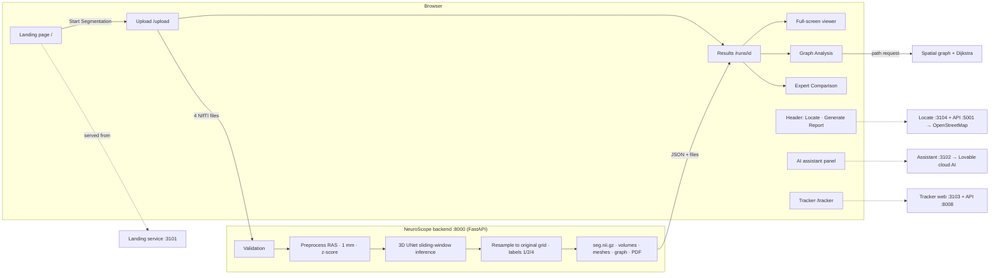

# NeuroScope 3D — Pitching Guide

*Written 2026-10-17 from the project's own code, configuration, test results and documentation. Every important claim names the file it comes from. Items marked **[NEEDS CONFIRMATION]** could not be verified from the repository.*

> **Golden rule for the pitch:** NeuroScope 3D is a **research and education prototype**. It is **not** a medical device and has **not** been clinically validated. Say "the model predicts" or "suspected tumour region", never "diagnoses".

---

## 1. Project overview

**What it is.** A web application that takes the four standard brain MRI scans of one patient (T1, T1Gd, T2, FLAIR). An AI model marks the parts of the image that look like brain tumour, and the app shows the result in linked 2D slices and a rotatable 3D brain. On top of that it offers measurements, a graph-based spatial analysis, comparison with an expert's tumour outline, and a PDF report. Four extra modules are connected to it: a landing page, a "find a neurologist" tool, an AI assistant, and a tool for comparing two scans taken at different times.

**The problem.** A brain tumour MRI is four separate 3D scans, and each contains about 155 slices. Outlining the tumour regions by hand is slow, and it is hard to picture where the regions are in 3D. Automatic segmentation (the computer drawing the outline) helps, but a raw outline is hard to inspect, measure and explain without good visualisation and reporting.

**Why segmentation is useful.** The tumour outline gives **volumes** (how big each region is), **location** (where it is in the brain), and a basis for **comparison** (against an expert's outline, or against an earlier scan).

**Intended users** (none of them has formally tested the tool): medical-imaging researchers, students and teachers, biomedical-engineering researchers, developers learning medical AI, and clinicians *evaluating it in a research setting*.

**What makes it more than a basic viewer:**
1. Real AI segmentation on the uploaded scans, written back on the scan's **own grid and orientation**.
2. Linked axial / coronal / sagittal / 3D views with layer controls and hover labels.
3. A **spatial graph** over the whole brain, with a **Dijkstra shortest path** between tumour components.
4. **Expert comparison** metrics, when the user supplies an expert mask.
5. A **one-click PDF report** built from the real results.
6. Integrated modules: landing page, Locate, AI assistant, Tracker.

### One sentence
"NeuroScope 3D turns four brain MRI scans into an AI-predicted, measurable, explorable 3D tumour map, with graph-based spatial analysis, expert comparison and a research report, all in the browser."

### 30-second introduction
"Brain tumour MRI comes as four 3D scans with hundreds of slices, so it is hard to see the tumour as a whole. NeuroScope 3D lets you upload those four scans. Our 3D U-Net model, trained on the public BraTS 2023 dataset, predicts the tumour regions in about ten seconds on a laptop GPU. You then explore them in linked 2D and 3D views, see their volumes, analyse how the tumour parts are connected with a Dijkstra shortest-path graph, compare against an expert outline, and download a PDF report. It is a research and teaching prototype, not a diagnostic tool."

### One-minute explanation
"Every brain tumour MRI study has four sequences: T1, T1 with contrast, T2 and FLAIR. Each shows the tumour differently. NeuroScope 3D takes all four, checks that they are valid and aligned, and runs a 3D U-Net that we trained ourselves on BraTS 2023 glioma data. The model labels three regions — necrotic core, oedema and enhancing tumour — and gives the standard groups WT, TC and ET. The result is saved on the patient's original scan grid, so it lines up exactly with the input.

In the browser you see the axial, coronal and sagittal slices and a 3D brain, all linked: click anywhere and every view follows. Our graph analysis turns the brain into a lattice of points and finds the shortest physical path between tumour parts with Dijkstra's algorithm. If you upload an expert outline, we compute Dice, sensitivity and precision. One click gives a PDF report. On 30 held-out development cases, the model reached Dice 0.875 for whole tumour."

### Two-minute pitching script
1. **Hook (15 s).** "A single brain-tumour MRI study is four 3D scans, roughly 600 images. Finding and measuring the tumour by eye is slow and hard to picture in 3D."
2. **What we built (25 s).** "NeuroScope 3D. You open our landing page, click Start Segmentation, and upload the four scans. The server checks every file — format, size, alignment — and refuses bad input with a clear message."
3. **AI (25 s).** "A 3D U-Net built with MONAI and PyTorch, trained by us on BraTS 2023 adult glioma data, predicts tumour core, whole tumour and enhancing tumour. We use exactly the same preprocessing as in training, and we write the result back onto the original scan grid. On an RTX 3050 laptop GPU, the whole request takes about 10 seconds."
4. **Explore (20 s).** "Results show the tumour volume and its composition. The linked viewer shows the slices and a 3D brain with the tumour surfaces. Hover with Show Definitions on and it tells you which region you are pointing at."
5. **Novelty (20 s).** "Our Graph Analysis turns the brain into a weighted lattice graph and uses Dijkstra's algorithm to find the shortest path between tumour components. It also tells you how much of that path runs through non-tumour tissue. This is a spatial-connectivity measurement, not a growth prediction."
6. **Trust (15 s).** "If an expert mask is available, we compute Dice, sensitivity, precision and error counts. On 30 patient-disjoint held-out cases, our Dice is 0.875 for whole tumour, 0.833 for core and 0.810 for enhancing tumour."
7. **Ecosystem (10 s).** "From the workspace you can find nearby neurologists, ask our AI assistant questions, or compare two scans over time with the Tracker."
8. **Close (10 s).** "It is a research and teaching prototype, open about its limits, and built to make brain tumour MRI understandable."

---

## 2. Problem statement
- **Many images.** One MRI study has 4 sequences (`T1`, `T1Gd`, `T2`, `FLAIR`), each a 3D volume (BraTS images are 240 × 240 × 155 voxels).
- **Each sequence shows different things.** Enhancing tumour is clearest on T1Gd; oedema on FLAIR/T2. You need all of them together.
- **3D is hard on a flat screen.** Slices show one plane at a time, so where the tumour parts sit in 3D, and how far apart they are, is hard to judge.
- **Manual outlining is slow.** Measuring volume needs an outline of every slice.
- **Checking an AI result needs tools.** You need overlays, layer controls, numbers, and comparison with an expert.

*Do not say* that existing hospital software "cannot do this" — we have not surveyed it. Say: "we bring segmentation, 3D exploration, graph analysis, comparison and reporting into one simple browser workflow for research and teaching."

## 3. Proposed solution (what is actually implemented)
1. **Upload** four NIfTI files (`.nii` / `.nii.gz`), plus an optional expert mask. Each file is validated as soon as it is chosen (`/api/validate-file`), and the set is checked for one shared voxel grid (`/api/validate-set`).
2. **Segmentation** on the server (`/api/predict` → `ml/pipeline.py`, `ml/inference.py`).
3. **Results page:** total volume, WT/TC/ET volumes, label composition, actions.
4. **Linked viewer** (NiiVue): 3 slice views + 3D, layers, opacity, Show Definitions, full-screen mode.
5. **Graph Analysis:** lattice graph, Dijkstra path, tumour components (`ml/spatial_graph.py`).
6. **Expert Comparison** (only if an expert mask was uploaded).
7. **Report:** a branded PDF (`ml/report_full.py`), plus download of the segmentation `SEG.nii.gz`.
8. **Integrated modules:** landing page, Locate, AI assistant, Tracker (section 14).

## 4. Target users and use cases
| User | Example use | Tested by them? |
|---|---|---|
| Imaging researchers | Run a model on BraTS-style data, inspect the outputs in 3D, export NIfTI and a PDF | No formal user testing |
| Students and teachers | Learn what WT/TC/ET mean and how MRI sequences differ; see a real AI pipeline | No |
| Biomedical engineers / developers | Study preprocessing, inference, resampling and the graph analysis | No |
| Clinicians (research setting only) | Evaluate model outputs against their own outline using the metrics | No |

All testing so far was done by the project team on public BraTS development data (`docs/TEST_RESULTS.md`). **There is no clinical approval and no diagnostic claim.**

## 5. Technology stack (verified in the repository)
| Technology | What it is | Why we use it | Where |
|---|---|---|---|
| **Python 3** | Programming language | ML and backend | `ml/`, `backend/`, `execution/`, `scripts/` |
| **PyTorch** (2.6.0+cu124 installed) | Deep-learning library | Runs the neural network on the GPU | `ml/inference.py`, training scripts |
| **MONAI** (1.6.0 installed) | Medical-imaging AI library built on PyTorch | The 3D UNet, transforms, sliding-window inference, Dice loss | `ml/inference.py`, `scripts/09_*` |
| **NiBabel** | NIfTI file reader/writer | Reads MRI files and their affine; writes the segmentation | `ml/inference.py`, `ml/report_full.py` |
| **NumPy / SciPy** | Numerical computing | Arrays; `scipy.ndimage` (connected components, morphology), `scipy.sparse.csgraph.dijkstra` | `ml/spatial_graph.py`, `ml/refinement.py` |
| **scikit-image** | Image processing | Marching cubes (`skimage.measure.marching_cubes`) for the 3D surface meshes | `ml/meshes.py` |
| **FastAPI + Uvicorn** | Python web API framework and server | Upload, validation, inference and result endpoints | `backend/main.py` |
| **ReportLab + Pillow** | PDF generation, image drawing | PDF report and its figures | `ml/report.py`, `ml/report_full.py` |
| **Next.js 16 (App Router) + React 19 + TypeScript** | Web framework, UI library, typed JavaScript | The workspace website | `frontend/` |
| **NiiVue 0.69** | WebGL MRI viewer | Linked 2D/3D views, overlays, meshes, graph overlays | `frontend/src/components/NiiVueViewer.tsx` |
| **lucide-react** | Icon set | All icons, including the brain mark | `frontend/src/components/*` |
| **Custom CSS design system** | Tokens and components | Cherry Cola / Vanilla Cream look | `frontend/src/app/globals.css`, `ui.tsx` |
| **pytest** | Python testing | 51 backend tests | `tests/` |
| **ESLint / tsc** | Code checks | Lint and type checks | `frontend/` |
| **Integrated modules** | TanStack Start + Vite + React (landing page, assistant, Tracker web); Vite + React + Express + Leaflet (Locate); FastAPI + MONAI SegResNet + SimpleITK (Tracker API) | Supplied feature projects | `C:\Users\hp\NeuroScope3D_modules\*` (in the ZIP under `modules/`) |

Also in `requirements.txt`: `networkx` (older graph extraction: `ml/graph_builder.py`, `scripts/05_extract_graphs.py`) and `tqdm`.

**Deployment platforms:** none configured. The app runs locally (`start.ps1`).

## 6. System architecture

**Data flow (as implemented):** four NIfTI files → server validation (format, gzip, 3D, finite values, shared grid, sanity check) → preprocessing → 3D UNet inference → probabilities resampled to the original grid, threshold 0.5 → labels 1/2/4 → volumes, optional refinement copy, tumour components, 3D meshes, processing PDF → the browser loads the files and shows them. Graph paths and the full report are computed on request.

**Browser vs server:** all AI, graph and report computation happens on the **server**. The browser renders (NiiVue WebGL), runs the Show Definitions hover picking, and handles navigation.

## 7. AI model and training
- **Architecture** (`docs/MODEL_CARD.md`, `ml/inference.py`): MONAI **3D UNet**, `in_channels=4`, `out_channels=3`, `channels=(16,32,64,128,256)`, `strides=(2,2,2,2)`, `num_res_units=2`. About 4.8 M parameters; the checkpoint file is 19.3 MB. *(A 3D U-Net is an encoder–decoder network: it shrinks the image to understand context, then expands it again to label every voxel. Skip connections keep fine detail.)*
- **Input:** 4 channels in this order: T1, T1Gd, T2, FLAIR.
- **Output:** 3 sigmoid channels — TC, WT, ET — each a yes/no per voxel, so the regions can overlap (they are nested).
- **Preprocessing** (identical in training and inference): reorient to RAS → resample to 1 mm → normalise intensity per channel (z-score on non-zero voxels).
- **Inference:** sliding window over 128³ blocks, 25 % overlap, fp32, deterministic.
- **Post-processing:** probabilities are resampled back to the original T1Gd grid using both affines, then thresholded at **0.5** (not tuned). Labels: ET → **4**, TC minus ET → **1** (NCR/NET), WT minus TC → **2** (oedema).
- **Checkpoint:** `models/baseline_checkpoints/best_metric_model.pth` (SHA-256 starts `2decff1363f7861e`). It is loaded once when the backend starts. **No training happens during normal use.**
- **Training** (from `docs/MODEL_CARD.md` and `scripts/09_resume_baseline_gpu.py`):
  - Data: BraTS 2023 Adult Glioma (GLI) training data, 1,251 scans.
  - Method: Dice loss (sigmoid), Adam with learning rate 1e-4, cosine schedule (T_max = 50), 50 epochs (resumed from epoch 13), 128³ random crops, flips and 90° rotations, mixed precision, RTX 3050.
  - Batch size: 1 (both `scripts/09_train_baseline_gpu.py` and `scripts/09_resume_baseline_gpu.py`).
- **Split:** seed 42, 875 / 187 / 189 scans. The split was made per scan, so some patients appear in both train and test. Evaluation therefore uses only **patient-disjoint** cases (`configs/heldout_cases.json`).
- **Results** (`results/heldout_eval.json`, 30 patient-disjoint held-out cases): mean Dice **WT 0.875, TC 0.833, ET 0.810**; sensitivity 0.921 / 0.904 / 0.853. These are development results, not hidden-test or clinical performance.
- **Do not cite** `results/baseline_metrics.json` ("0.81 test Dice"). It came from the overlapping split and old preprocessing.

## 8. MRI sequences and tumour regions
| Sequence | Plain meaning | Why it helps |
|---|---|---|
| **T1 (t1n)** | Native T1-weighted: good anatomy | Brain structure |
| **T1Gd (t1c)** | T1 after gadolinium contrast | Shows *enhancing* tumour, where contrast leaks through a broken blood–brain barrier |
| **T2 (t2w)** | T2-weighted: fluid is bright | Oedema and tumour extent |
| **FLAIR (t2f)** | T2 with the fluid signal suppressed | Oedema around the tumour stands out clearly |

| Label / region | Meaning |
|---|---|
| **1 — NCR/NET** | Necrotic / non-enhancing tumour core (dead or non-enhancing tissue) |
| **2 — Oedema** | Swelling around the tumour (peritumoral oedema) |
| **4 — ET** | Enhancing tumour (lights up on T1Gd) |
| **WT** = 1 + 2 + 4 | Whole tumour |
| **TC** = 1 + 4 | Tumour core |
| **ET** = 4 | Enhancing tumour |

The model **predicts** these regions. They are not verified clinical findings. Note that BraTS 2023 itself uses label 3 for ET; this project writes **4**, the BraTS 2021 convention (`ml/inference.py`).

## 9. 3D visualisation
- **Library:** NiiVue (WebGL) in `frontend/src/components/NiiVueViewer.tsx`.
- **2D slices:** axial (top-down), coronal (front), sagittal (side), shown together with the 3D view in a 2 × 2 grid.
- **Linked crosshair:** clicking a view moves one shared 3D point, so all views jump to it. A readout shows world coordinates (mm) and the voxel index. Tested to within 1 voxel (`docs/TEST_RESULTS.md`, Test 6).
- **3D:** volume rendering of T1Gd, plus tumour surface meshes (WT/TC/ET) and a brain surface, made on the server (`ml/meshes.py`). Drag to rotate, scroll to zoom, as NiiVue provides.
- **Layers menu:** turn each label on/off, label opacity, surface on/off and opacity, model prediction / refined / expert layer, Show Definitions.
- **Show Definitions:** hover to see the name of the region or graph object under the pointer. It uses NiiVue's real coordinates and ray casting (`frontend/src/lib/picking.ts`).
- **Value:** it helps people *explore* spatial relationships. We make **no claim** that it improves diagnostic accuracy.

## 10. Mathematical model and Graph Analysis (`ml/spatial_graph.py`)
- **Vertices:** the brain is cut into small blocks (default about 4 mm). A block becomes a vertex if at least half of it is brain (brain = non-zero T1Gd/FLAIR, holes filled) or if it contains any predicted tumour. The vertex position is the block centre in real-world mm (via the scan's affine), and its class is the majority predicted label.
- **Edges:** each vertex connects to its touching neighbours (26 directions: faces, edges, corners).
- **Edge length:** the physical distance in mm between the block centres, computed with the affine, so non-square voxels are handled correctly.
- **Cost modes:**
  - **Mode A (physical distance):** cost = length.
  - **Mode B (experimental):** cost = length × the average of the two vertex weights, where weight = 1 for tumour vertices and α (1–100, user-chosen) for non-tumour vertices. This only expresses a *preference* to stay inside the predicted tumour.
- **Lattice spacing:** 3, 4 or 6 mm (a user choice) controls the block size.
- **Dijkstra:** `scipy.sparse.csgraph.dijkstra` finds the lowest-cost path from source to destination. Sources and destinations are tumour components (each represented by its vertex nearest the centroid) or the current crosshair point.
- **Outputs:** path length in mm, straight-line distance, number of steps, length through each tissue class, and the vertex sequence drawn in 3D.
- **Tumour components:** 26-connected pieces of predicted WT, each with a volume, a centroid and its label breakdown.
- **Graph overview:** vertex, edge and connected-component counts, plus integrity checks.
- **What the path means:** "the shortest route through the brain lattice between two predicted tumour parts, and how much of it is tumour or non-tumour". It is **spatial-connectivity analysis**. It does **not** predict tumour growth or spread.
- **Separate earlier feature:** `ml/graph_analysis.py` computes a voxel-level geodesic extent inside the predicted tumour (an older, descriptive measurement), separate from the lattice graph.
- **Tests:** 11 test functions in `tests/test_spatial_graph.py` (path length equals the sum of edges, the triangle inequality, symmetric graphs, and similar).

## 11. Mathematical refinement (`ml/refinement.py`, `ml/refinement_compare.py`)
- **What it does:** removes isolated predicted tumour fragments **smaller than 10 mm³** (26-connected WT components). This produces a separate `seg_refined.nii.gz`; **the original prediction is never changed**.
- **Evaluation** (`results/refinement_eval_summary.json`, 30 held-out cases): mean Dice change WT +0.0008, TC 0, ET 0 — **no meaningful improvement**. The unrefined prediction stays the primary output.
- **Status:** hidden from the main navigation and Results. It is still available at `/runs/<id>/refinement`, as a layer option ("Refined") in the Layers menu, and as a section of the PDF.

## 12. Expert Comparison (`ml/inference.py` → `compare_to_reference()`, `frontend/src/app/runs/[id]/expert/page.tsx`)
**It needs an expert mask** uploaded with the scans (labels 0/1/2/4, or 3 for ET; same grid). Without one, the page says so and no metrics are shown.

| Metric | Formula | Plain meaning |
|---|---|---|
| **Dice** | 2·TP / (2·TP + FP + FN) | Overlap: 1 = identical, 0 = no overlap |
| **Sensitivity** | TP / (TP + FN) | How much of the expert's tumour the model found |
| **Precision** | TP / (TP + FP) | How much of the model's tumour is also in the expert's outline |
| **False-positive voxels** | FP | The model said tumour, the expert did not |
| **False-negative voxels** | FN | The expert said tumour, the model missed it |
| **Volumes and difference** | model mL − expert mL | Size disagreement |

(TP = voxels both call tumour.) **IoU is not computed.** These metrics describe agreement with *that* reference only; they are not clinical validation.

## 13. Report generation (`ml/report_full.py`, `POST /api/runs/{id}/report`)
- **Generate Report** in the header or on Results builds a fresh PDF from the current case and opens it in a new tab (with a toast link as a fallback).
- **Sections:**
  1. Overview, with the one disclaimer
  2. MRI sequences (grid, spacing, hashes, previews)
  3. Segmentation volumes + 3-plane overlay
  4. Refinement table
  5. Graph analysis (stats, components, the selected path, tissue breakdown, figure) — if a graph can be built
  6. Expert comparison — only with an expert mask
  7. Technical appendix (model, methods, development evaluation, hashes, limitations)
- **Download:** the PDF opens in the browser (save it from there). **Download SEG.nii.gz** gives the mask.

## 14. The four integrated modules
All four run as their own services; the workspace shows them in frames. Details: `INTEGRATION_REPORT.md`.

| Module | Purpose | How you open it | Runtime | Status |
|---|---|---|---|---|
| **A. Landing page** | Public front page: hero with a 3D wireframe brain, "Process", "What we do", "Novelty" sections | `http://localhost:3000/` | TanStack Start node build on :3101, served at `/` by a Next.js rewrite | **Implemented and tested** — Start Segmentation opens `/upload` (verified by a click) |
| **B. Locate** | Find neurologists, neurosurgeons and hospitals near a place or your location (OpenStreetMap; no API key) | **Locate** button in the header → `/locate` | Vite :3104 + Express API :5001 (Overpass and Nominatim) | **Implemented and tested** — "Pune" gave 19 real facilities |
| **C. AI assistant** | Answers questions about MRI, WT/TC/ET, metrics and the project (text, with optional voice) | Brain button at the bottom-right → floating panel | TanStack Start :3102. Uses `LOVABLE_API_KEY` if set; otherwise forwards to the module's own Lovable cloud app (Gemini model) | **Implemented and tested** (real answers and a follow-up). **Requires configuration** for your own key. It **cannot** read your scans: no case data is sent |
| **D. Tracker** | Compares two studies of the same patient over time: segments both (MONAI SegResNet), aligns them (SimpleITK rigid registration), reports volume change and a change map plus a PDF | 6th item of the circular menu → `/tracker` | Web :3103 + FastAPI :8008 | **Implemented and tested through its API** (BraTS-GLI-00008 000 → 001, complete in 12 s; its results page rendered). Its built-in demo button is broken (a module bug) |

**Inputs:** Tracker needs T1, T1Gd, T2 and FLAIR for each study (`.nii` / `.nii.gz`, ≤ 1 GB per file). Locate needs a place name or browser location.

## 15. End-to-end workflow
1. Open **http://localhost:3000** — the landing page.
2. Click **Start Segmentation** → Upload page.
3. Add **T1, T1Gd, T2, FLAIR** (and optionally an expert mask). Each card turns **Valid** or shows an error.
4. Click **Start Segmentation** → upload progress → processing (about 10 s on an RTX 3050) → **Results**.
5. Read the total volume and WT/TC/ET; open **Layers** to toggle regions, surfaces and Show Definitions.
6. **Full-screen 3D Viewer** for a larger view.
7. **Graph Analysis:** choose source and destination components, a mode and a spacing → path length and tissue breakdown.
8. **Expert Comparison** (if a mask was uploaded) → metrics table.
9. **Locate** (header), the **AI assistant** (bottom-right), **Tracker** (menu).
10. **Generate Report** → PDF; **Download SEG.nii.gz** on Results.

## 16. Novelty and differentiators (defensible wording)
- **Most defensible claim:** "We **combine** AI segmentation written on the original scan grid, linked 2D/3D exploration, a physically measured spatial lattice graph with Dijkstra paths between tumour components, expert-reference metrics and an automatic report in **one browser workflow**."
- **Graph analysis:** applying Dijkstra on a brain lattice weighted by real millimetres between predicted tumour components, with a breakdown of the path by tissue, is an unusual *descriptive* tool. It is **not** a validated biological model. We have not done a literature search to claim it is first-of-its-kind **[NEEDS CONFIRMATION if you want to say "first"]**.
- **Honesty features:** preprocessing parity, original-grid output, refusal of invalid inputs, and documented limitations.
- **Ecosystem:** Locate, assistant and Tracker make it a small platform rather than a single demo.

## 17. Limitations and future scope
**Current limitations**
- Development Dice only (30 BraTS 2023 GLI cases); no hidden-test, external or clinical validation.
- Over-predicts enhancing tumour in tumours with little or no enhancement (blind case: ET Dice 0).
- Adult pre-operative glioma, skull-stripped and co-registered inputs only. Other inputs are out of distribution, and the sanity check is heuristic.
- BraTS 2023 includes BraTS 2021 patients, so evaluation on BraTS 2021 may overlap the training data (`docs/ORGANISER_QUESTIONS.md`).
- Expert comparison needs a user-supplied mask.
- Timing measured only on an RTX 3050; CPU and T4 timings were never measured.
- No public deployment; seven local services; the assistant depends on an external AI service.
- Not a medical device; no clinical approval.

**Future scope:** external validation, uncertainty maps, better handling of ET, CPU/T4 benchmarks, a secure deployment, user studies with clinicians, Tracker integration with NeuroScope cases (with explicit consent).

## 18. Installation, execution and deployment
- **Prerequisites:** Windows; Python 3 with a venv; Node.js and npm; an NVIDIA GPU recommended (CPU fallback exists in `ml/inference.py` but was not timed).
- **Install:**
  1. `python -m venv venv`
  2. `venv\Scripts\pip install -r requirements.txt` (CUDA build of torch recommended)
  3. `cd frontend && npm install`
  4. For each module: `npm install` in its folder, then the build or start commands in `INTEGRATION_REPORT.md` §2.
  5. For the Tracker API: `pip install -r backend/requirements.txt` (or SimpleITK into a separate folder, as done here).
- **Run everything:** `powershell -ExecutionPolicy Bypass -File .\start.ps1` → http://localhost:3000. Use `-NoIntegrations` for only the workspace and backend.
- **Model:** `models/baseline_checkpoints/best_metric_model.pth` must exist (it is in the ZIP).
- **Tests:**
  - `venv\Scripts\python -m pytest tests -q -p no:cacheprovider -W ignore` (51 tests; needs the BraTS data in `data/raw`)
  - `cd frontend && npx tsc --noEmit -p . && npx eslint src && npx next build`
- **Production:** set `NEXT_PUBLIC_*` and `NEUROSCOPE_LANDING_ORIGIN`, and host the backend on a GPU machine. **No deployment exists yet.**

## 19. Data, privacy and security
- **Uploads:** four MRI NIfTI files and an optional expert mask, sent only to our own backend.
- **Storage:** each case gets a random 32-character ID. T1 and T2 are deleted after processing; T1Gd, FLAIR, the masks, meshes and reports stay in `backend/runs/<id>` and are **deleted automatically after 23 hours**, or immediately with **Delete** (`backend/main.py`).
- **External services:**
  - The **AI assistant** sends typed chat messages to an external AI service (the module's Lovable cloud app, Gemini). No scans or case data are sent.
  - **Locate** sends the searched place or coordinates to OpenStreetMap services.
  - The **Tracker** keeps its uploads in its own `backend/storage` and deletes data older than 24 hours; the check runs on each API request (`backend/app/config.py` `cleanup_expired_data`, called from a middleware in `backend/app/main.py`).
- **Never commit:** `.env` files (the Locate `.env` holds Google API keys), real patient scans, `backend/runs`, `data/raw`.
- **For deployment:** HTTPS, authentication, secrets kept in server environment variables, de-identified data only.

## 20. Conclusion
"NeuroScope 3D shows that a student team can build a careful, end-to-end brain tumour MRI pipeline. It segments with our own trained 3D U-Net, keeps results faithful to the original scan, makes them explorable in linked 2D and 3D, adds a graph-based spatial analysis with Dijkstra, measures agreement with experts, and documents everything in a report. We are open about what it is: a research and teaching prototype with development-set results. Next we want external validation, better enhancing-tumour accuracy, and a secure deployment. Thank you."
